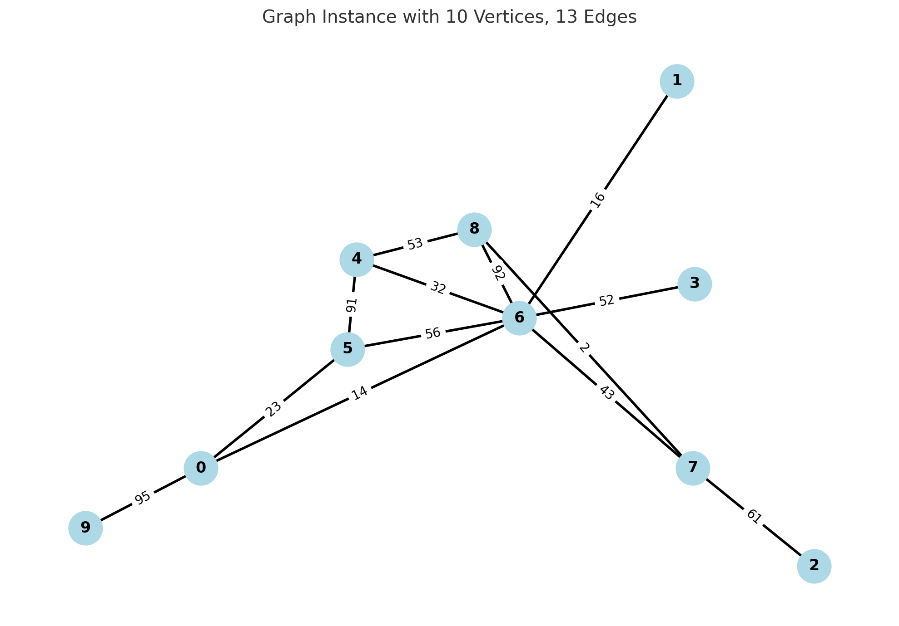

[](https://pubsonline.informs.org/journal/ijoc)

# Balanced spanning forests of graphs: Hardness and solving methods

This archive is distributed in association with the [INFORMS Journal on
Computing](https://pubsonline.informs.org/journal/ijoc) under the [MIT License](LICENSE).
Files carrying a separate license notice and third-party components retain their original licenses.

The software and data in this repository accompany the paper
[Balanced spanning forests of graphs: Hardness and solving methods](https://doi.org/10.1287/ijoc.2025.1551)
by **Morteza Davari, Phablo F. S. Moura, and Hande Yaman**.
An earlier version of the paper is available as [arXiv:2504.02421](https://arxiv.org/abs/2504.02421).

The authors' public code repository is
[Edge-Weighted-Balanced-Connected-Partitions](https://github.com/md6712/Edge-Weighted-Balanced-Connected-Partitions).
The IJOC archive for this contribution is [INFORMSJoC/2025.1551](https://github.com/INFORMSJoC/2025.1551).

## Cite

Please cite both the paper and this repository using their respective DOIs:

- Paper: [10.1287/ijoc.2025.1551](https://doi.org/10.1287/ijoc.2025.1551)
- Code repository: [10.1287/ijoc.2025.1551.cd](https://doi.org/10.1287/ijoc.2025.1551.cd)

BibTeX for this repository snapshot:

```bibtex
@misc{davari2026balancedspanningforests,
  author =    {Davari, Morteza and Moura, Phablo F. S. and Yaman, Hande},
  publisher = {INFORMS Journal on Computing},
  title =     {{Balanced spanning forests of graphs: Hardness and solving methods}},
  year =      {2026},
  doi =       {10.1287/ijoc.2025.1551.cd},
  url =       {https://github.com/INFORMSJoC/2025.1551},
  note =      {Available for download at https://github.com/INFORMSJoC/2025.1551}
}
```

Additional BibTeX for the paper (provisional journal citation; the publication year, volume, issue, and pages will be added when confirmed by the publisher):

```bibtex
@article{davariBalancedSpanningForestsPaper,
  author =  {Davari, Morteza and Moura, Phablo F. S. and Yaman, Hande},
  title =   {{Balanced spanning forests of graphs: Hardness and solving methods}},
  journal = {INFORMS Journal on Computing},
  doi =     {10.1287/ijoc.2025.1551},
  url =     {https://doi.org/10.1287/ijoc.2025.1551}
}
```

## Overview

This code provides mathematical formulations, exact algorithms, and a heuristic for the **min-max balanced spanning forest** problem, previously described as edge-weighted balanced connected partitioning. The objective is to partition an edge-weighted graph into a prescribed number of vertex-disjoint trees spanning all vertices while minimizing the weight of the heaviest tree.

## Directory Structure

- **`solver/`**: contains the solver implementations, the experiment driver `main.cpp`, and the configuration file `Setting.txt`.

- **`instance-generation/`**: contains `generate_instances.cpp`, the separate program used for generating test instances.

- **`Computational Results/`**: contains the results workbook `Final-Results.xlsx`.

- **`Instances/`**: provides the 1,368 saved graph instances in `min-max-bsf.zip`.

- **`solver/instances/` and `solver/output/`**: runtime directories to prepare locally before running. Extract the saved instances into the first directory; the driver writes results into the second. See [RUNNING.md](RUNNING.md#3-prepare-the-inputs-and-launch-the-solver).

## Compilation

**Platform note:** This is the original **Windows implementation**, developed using **Visual Studio, the MSVC v143 toolset, and C++17**. Preparing this source-only archive did not change the contents of the retained C++ source files. No Linux port has been applied.

This repository distributes source files without Visual Studio solutions/projects, compiled binaries, or generated dependency builds. Create a local build configuration with your preferred tools.

Install the dependencies needed by the program you want to build:

- [Boost](https://www.boost.org/) (for the instance generator)
- [LEMON](https://lemon.cs.elte.hu/trac/lemon)
- [IBM ILOG CPLEX](https://www.ibm.com/products/ilog-cplex-optimization-studio)
- [CSFML](https://www.sfml-dev.org/download/csfml/) (the C binding of SFML, used by the solver's rendering code)

The paper reports an experiment environment using Boost **1.80.0**, LEMON **1.3.1**, and CPLEX **22.1.1**. The former generator project referenced Boost **1.84.0**; its project/package files are not distributed in this source-only layout. The CSFML version is not recorded.

Build the solver and instance generator as separate executables: their entry points are `solver/main.cpp` and `instance-generation/generate_instances.cpp`. [RUNNING.md](RUNNING.md) lists the solver translation units, compiler settings, include paths, and link libraries needed to configure a local build. CPLEX requires a valid license; its license is separate from this repository's MIT license.

There is no application Makefile or CMake configuration. Building on Linux or with a different compiler requires compatibility work: the source uses Windows APIs, Microsoft CRT functions, and Windows path/case conventions. The guide identifies these locations; an unchanged Linux build has not been validated.

## Running the experiments

See [RUNNING.md](RUNNING.md) for local build setup, input preparation, every setting, examples for each algorithm, and the output-column definitions.

1. Configure and build a local solver executable as described above.
2. Edit `solver/Setting.txt` to select the method and instance subset, preserving the existing label/value layout. The method choices are `1` (cycle-elimination), `2` (flow), `3` (set-cover/partition), `4` (branch-and-price), and `5` (preprocessing only). The checked-in file selects `5`.
3. Extract `Instances/min-max-bsf.zip` and prepare `solver/instances/` and `solver/output/` as described in the guide. Set the process working directory to `solver/` and launch your solver executable.
4. Collect the timestamped text files in `solver/output/`. The supplied results workbook is `Computational Results/Final-Results.xlsx`.

The instance selection and algorithm settings are handled in `solver/main.cpp`; some run limits and settings are also specified in the source files. Reproducing a particular table requires matching the method, instance subset, and parameter settings used in the paper. The repository does not currently include a single script that regenerates all paper tables and figures.

For runs with the supplied driver, use the saved files extracted from `Instances/min-max-bsf.zip`. Regenerating instances does not guarantee the same graphs because the generator uses a time-based random seed. A generated file can have the same name as a benchmark file but different contents.

The current source defines a 10,800-second CPLEX time limit in `solver/Cplex.h`. The paper specifies 1,800 seconds for instances with at most 20 vertices and 10,800 seconds for instances with at least 30 vertices. Match the run configuration to the paper before comparing results; the default configuration is not a complete replication recipe.

## 📂 Instances Directory

The `Instances/` directory contains benchmark graphs used to evaluate the performance of our algorithms. Each instance defines an undirected edge-weighted graph and the number of desired partitions (connected components/trees).

### 🔖 File Format

Each instance file is a plain text file with the following structure:

- `n` – Number of vertices (vertices are labeled from `0` to `n−1`)
- `m` – Number of undirected edges
- `k` – Number of connected partitions (trees) into which the graph should be divided
- Each line that follows contains:
  - `uᵢ` and `vᵢ` – Endpoints of the edge
  - `wᵢ` – Non-negative weight of the edge

### 📘 Example
```txt
10	13	2
3	 6 	 52
4	 5 	 91
0	 6 	 14
4	 6 	 32
8	 4 	 53
7	 8 	 2
5	 0 	 23
0	 9 	 95
2	 7 	 61
6	 1 	 16
6	 5 	 56
6	 8 	 92
7	 6 	 43
```



## Support

For questions about the code or experiment settings, contact the authors listed in [AUTHORS](AUTHORS).

## Acknowledgments and third-party notices

We thank [Shunji Tanaka](https://sites.google.com/site/shunjitanaka/home) for making his research software publicly available. The memory-management routines in `solver/memory.cpp`, `solver/memory.h`, `solver/bmemory.cpp`, and `solver/bmemory.h` include his code and adaptations of it. His original copyright notices and redistribution terms are retained.

LEMON, CPLEX, CSFML, and Boost are external dependencies and retain their respective licenses. Their binaries and generated build trees are not bundled in this source-only distribution. Separate notices in the source files continue to apply.
